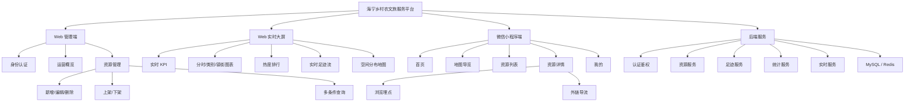
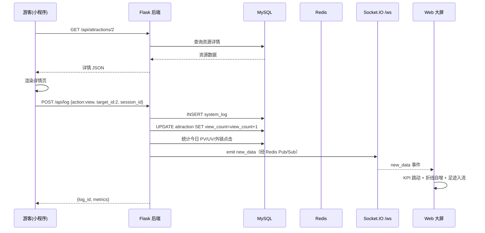
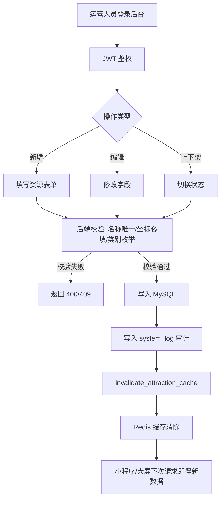
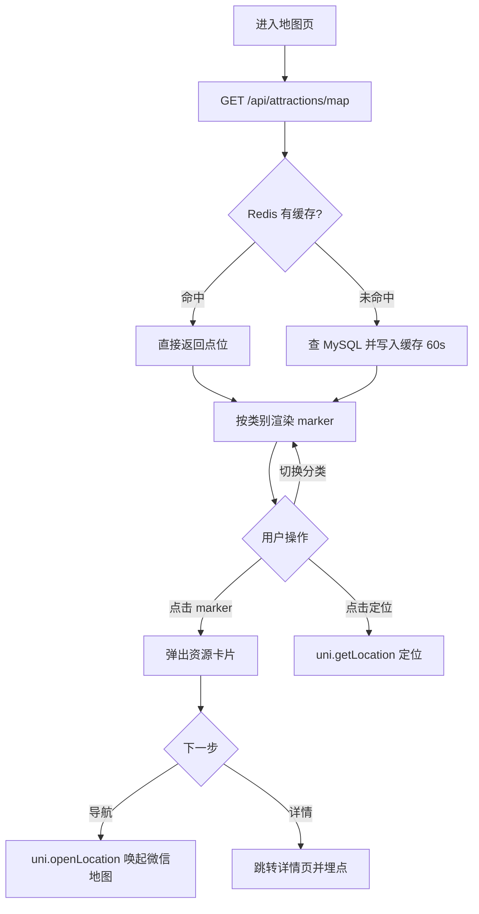
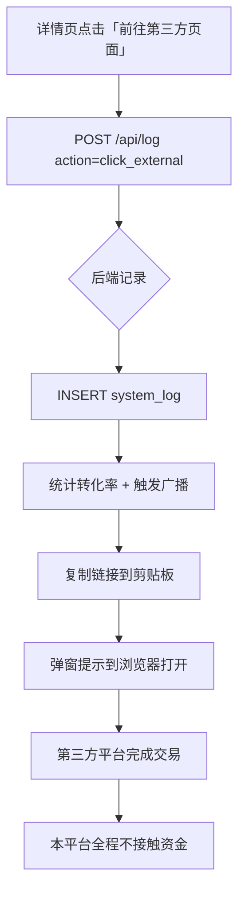
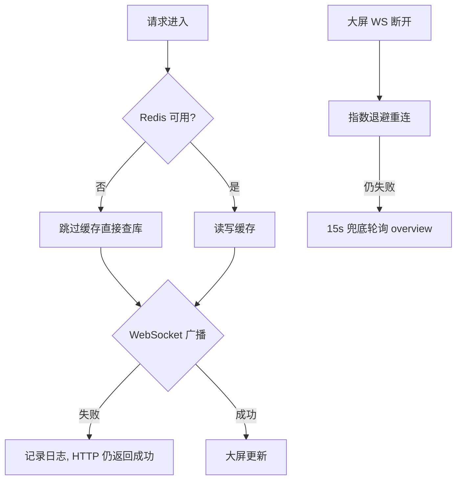

# 系统功能结构图与核心业务流程

> 项目：基于WebGIS的海宁乡村农文旅服务平台设计与实现
> 文档类型：05_文案 · 系统功能结构图 + 核心业务流程说明（作品规范明确要求项）
> 说明：以下图表使用 Mermaid 编写，可在 Typora / VS Code / GitHub 直接渲染；论文插图已另行导出 PNG。

---

## 一、系统功能结构图

### 1.1 层级结构（文字版，可直接用于论文排版）

```
海宁乡村农文旅服务平台
├─ Web 管理端（Vue3 + Element Plus）
│  ├─ 身份认证
│  │  ├─ 管理员登录（JWT）
│  │  ├─ 账号信息查看
│  │  └─ 修改密码
│  ├─ 运营概览
│  │  ├─ KPI 指标卡（PV / UV / 外链点击 / 转化率）
│  │  ├─ 今日分时浏览量折线
│  │  ├─ 资源类别分布饼图
│  │  ├─ 热度排行条形图
│  │  └─ 海宁市资源分布地图
│  └─ 资源管理
│     ├─ 多条件查询（关键词 / 类别 / 镇街 / 状态）
│     ├─ 新增资源
│     ├─ 编辑资源
│     ├─ 删除资源
│     └─ 上架 / 下架
├─ Web 实时数据大屏（Vue3 + ECharts）
│  ├─ 实时 KPI（PV / UV / 外链点击 / 转化率，含跳动动画）
│  ├─ 今日分时浏览量
│  ├─ 资源类别分布
│  ├─ 镇街资源分布
│  ├─ 资源热度排行
│  ├─ 海宁市资源空间分布（Leaflet）
│  ├─ 实时足迹滚动流（WebSocket）
│  └─ 连接状态指示与断线重连
├─ 微信小程序端（Uni-app）
│  ├─ 首页
│  │  ├─ 平台概况（资源数 / 镇街数 / 类别数）
│  │  ├─ 快捷入口（地图导览 / 资源浏览 / 果园采摘 / 古镇古村）
│  │  ├─ 热门推荐（按浏览量）
│  │  └─ 黄湾水果采摘月历
│  ├─ 地图导览
│  │  ├─ 海宁市资源点位标注
│  │  ├─ 类别筛选
│  │  ├─ 点位信息卡片
│  │  ├─ 一键导航
│  │  └─ 当前位置定位
│  ├─ 资源列表
│  │  ├─ 分类切换
│  │  ├─ 关键词搜索
│  │  └─ 分页加载
│  ├─ 资源详情
│  │  ├─ 图文介绍
│  │  ├─ 坐标与地址
│  │  ├─ 导航跳转
│  │  ├─ 外链导流（零支付）
│  │  └─ 浏览埋点（view / click_external）
│  └─ 我的
│     ├─ 设备会话号
│     ├─ 本地浏览历史
│     └─ 平台说明
└─ 后端服务（Flask）
   ├─ 认证与鉴权（JWT + 密码加盐）
   ├─ 资源服务（CRUD + 上下架 + 缓存）
   ├─ 足迹服务（上报 / 查询 / 原子自增）
   ├─ 统计服务（今日指标 / 大屏概览）
   ├─ 实时服务（Socket.IO `/ws` + Redis Pub/Sub）
   └─ 基础设施（MySQL / Redis / 日志 / 统一响应体）
```

### 1.2 结构图（Mermaid）



---

## 二、核心业务流程

### 流程 1：游客浏览 → 大屏实时跳动（本平台最核心链路）



**时序说明**

1. 详情请求与埋点分离：详情接口**无副作用**，避免后台预览或页面刷新污染 PV。
2. 埋点为"发后不理"：小程序 `track()` 内部 `catch` 掉所有异常，网络抖动不会阻塞游客浏览。
3. 广播失败不影响 HTTP 返回：`broadcast_new_data()` 捕获异常并降级，保证写库成功即视为成功。

### 流程 2：资源发布与多端同步



### 流程 3：地图导览与导航



### 流程 4：零支付外链导流



### 流程 5：异常与降级



---

## 三、数据流说明（论文可用）

```
[小程序] --HTTP--> [Flask API] --SQLAlchemy--> [MySQL]
                        |                        ↑
                        |--缓存读写--> [Redis] --+
                        |
                        |--Pub/Sub--> [Socket.IO 服务端] --WS--> [Web 大屏]
                        |
                        +--静态资源--> [GeoJSON 底图] --> [Leaflet / 微信地图]
```

关键点：

1. **MySQL 是唯一事实来源**，Redis 只做缓存与消息通道，二者不产生数据分歧；
2. **GeoJSON 底图随前端静态部署**，不依赖第三方瓦片服务，断网也能显示海宁轮廓（答辩演示友好）；
3. **WebSocket 只传增量**，首屏由 `GET /api/stats/overview` 提供，避免每次都全表统计。

---

## 四、图表导出清单（论文插图用）

已用 `scripts/gen_figures.py` 调用 mermaid.ink 渲染为 PNG，存放于 `docs/figures/`：

| 文件 | 对应内容 | 图类型 | 尺寸 (px) |
|---|---|---|---|
| `fig_01.png` | 系统功能结构图 | 层级图 | 1904 × 242 |
| `fig_02.png` | 流程 1：浏览 → 大屏实时跳动 | 时序图 | 见文件 |
| `fig_03.png` | 流程 2：资源发布与多端同步 | 流程图 | 见文件 |
| `fig_04.png` | 流程 3：地图导览与导航 | 流程图 | 见文件 |
| `fig_05.png` | 流程 4：零支付外链导流 | 流程图 | 197 × 1086 |
| `fig_06.png` | 流程 5：异常与降级 | 流程图 | 见文件 |

> 排版建议：`fig_01` 为横向长图（宽高比约 8:1），论文单栏排版时缩小后文字会偏小。建议二选一：
> ① 正文使用 1.1 节的文字树（缩进结构），`fig_01` 放附录；
> ② 拆成 4 张"分端结构图"分别插入 3.x 各节，每张只画一个终端的三级结构。
> 其余 5 张流程图均为常规比例，可直接双栏/单栏插入。
>
> 重新生成：`python scripts/gen_figures.py`（需联网，依赖 mermaid.ink 在线渲染）。
